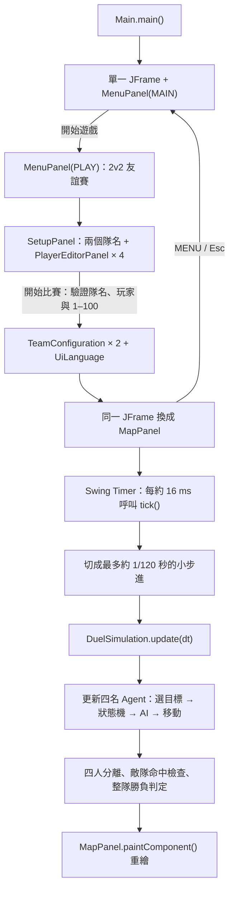

# NWMANAGER 程式碼說明

[Version française](README.fr.md)

NWMANAGER 是以 Java Swing 製作的俯視角 2v2 刺刀團隊戰原型。藍隊與紅隊各有兩名 Agent；每人會在戰鬥中選擇敵方目標、回應較危險的攻擊、協助受壓迫的隊友並避免和隊友重疊。這份中文版 README 的重點不是只描述玩法，而是說明程式碼如何把 Agent 能力、AI 決策、二維移動、目標選擇、武器角度、攻防狀態、碰撞及畫面繪製串在一起。

目前的勝負不是由「命中率」直接抽籤決定。能力值先影響 Agent 的觀察、選擇與操作誤差，之後仍須由實際位置、刺刀尖端、攻擊高度、格擋方向及狀態時間共同完成判定。

## 執行方式

專案使用 JDK 25。可以直接在 IntelliJ IDEA 執行 `Main`，或在專案根目錄使用 PowerShell：

```powershell
javac -encoding UTF-8 -d .\out .\src\*.java
java -cp .\out Main
```

程式會先開啟主選單。操作流程是「開始遊戲」→「2v2 友誼賽」→「建立兩支隊伍」→「開始比賽」。隊伍建立頁的藍、紅隊分成兩個分頁，每隊可以輸入隊名並設定兩名玩家。右上角的 `中文`／`Français` 按鈕會切換目前頁面語言；選定語言會沿著整段導覽繼續傳入戰鬥頁。

操作鍵：

| 按鍵 | 對應程式行為 |
| --- | --- |
| `Space` | 切換 `MapPanel.paused` |
| `R` | 呼叫 `MapPanel.reset()`，再執行 `DuelSimulation.reset()` |
| `L` | 在所有頁面切換 `UiLanguage.FRENCH` 與 `UiLanguage.CHINESE` |
| `Enter` | 執行選單主要按鈕，或在隊伍建立頁開始比賽 |
| `Esc` | 返回上一頁；戰鬥中則回到主選單 |
| `0` | 設為 0.25 倍速 |
| `5` | 設為 0.5 倍速 |
| `1`、`2`、`4` | 修改 `MapPanel.speed` |

戰鬥畫面左上方也有 `0.25×`、`0.5×`、`1×`、`2×`、`4×` 五個可點擊按鈕；目前速度的按鈕會停用，方便直接辨認。右上角的 `MENU`／「主選單」會停止目前的 Swing `Timer` 再返回主選單，避免離開後戰鬥仍在背景運行。

## 建議閱讀順序

第一次閱讀程式碼時，建議依照以下順序：

1. `Main.java` 與 `MenuPanel.java`：同一個視窗如何在主選單、模式選擇、隊伍建立和戰鬥間導覽。
2. `SetupPanel.java` 與 `PlayerEditorPanel.java`：兩支隊伍、四名玩家及「開始比賽」驗證。
3. `TeamConfiguration.java`、`AgentConfiguration.java`、`AgentStats.java` 與 `Tactic.java`：隊名、玩家、十一項能力及戰術如何保存。
4. `MapPanel.java`：計時器如何推進模擬，以及畫面如何重繪。
5. `DuelSimulation.java`：主要戰鬥規則、AI、移動與命中判定。
6. `Musketeer.java`：一名 Agent 保存哪些即時資料，以及刺刀尖端如何計算。
7. `CombatState.java`、`Decision.java` 及其他 enum：戰鬥狀態、決策、方向、部位與介面語言。

## 程式執行關係



`DuelSimulation` 不依賴 `MapPanel`，所以可以不建立 Swing 視窗而直接大量模擬。不過目前 `Musketeer` 仍包含 `paint()`，而 `DuelSimulation.reset()` 也使用 `java.awt.Color`；因此模型與顯示尚未完全拆成兩個模組，只是戰鬥推進本身不需要 Swing 元件。

## 檔案與職責

| 檔案 | 主要職責 |
| --- | --- |
| `Main.java` | 在 Swing EDT 管理單一 `JFrame`，切換主選單、模式、隊伍建立與戰鬥頁 |
| `MenuPanel.java` | 主選單與「開始遊戲／2v2 友誼賽」頁面、語言、返回及離開動作 |
| `SetupPanel.java` | 兩個隊名、藍紅分頁、四張玩家表單、返回、語言及中法驗證訊息 |
| `PlayerEditorPanel.java` | 單一玩家的中法標籤、戰術下拉選單和十一個 1–100 數值欄位 |
| `AgentConfiguration.java` | 綁定玩家名稱、不可變 `AgentStats` 與 `Tactic`，並保存預設設定 |
| `TeamConfiguration.java` | 綁定隊名與兩份已驗證的 `AgentConfiguration` |
| `Tactic.java` | 防守、中立、進攻三種戰術的中法標籤及 AI 修正值 |
| `MapPanel.java` | 計時、暫停、倍速、快捷鍵、語言、返回主選單、競技場與資訊面板 |
| `DuelSimulation.java` | 建立兩隊、周邊感知、目標選擇、背刺機會、護背、雙重格擋、AI、移動、碰撞、傷害與整隊勝負 |
| `Musketeer.java` | Agent 隊伍、目標、各敵人感知表、雙重格擋、即時狀態、刺刀幾何、攻擊時間與外觀繪製 |
| `OpponentAwareness.java` | 單一敵人的可見性、最後位置、記憶時間，以及已觀察的上下攻擊／格擋次數 |
| `AgentStats.java` | 十一項不可變能力值，以及護背、感知、雙重格擋、交戰、假動作與變速刺的衍生計算 |
| `EngagementPhase.java` | 試探、承諾進攻、穿越、脫離與重整五段空間循環 |
| `AttackManipulation.java` | 當次攻擊使用一般刺、加速刺或延遲刺 |
| `CombatState.java` | Agent 目前處於哪個戰鬥階段 |
| `Decision.java` | AI 目前想執行的動作及中法文字 |
| `CombatDirection.java` | 上下段攻擊的距離、時間、顏色與符號 |
| `BlockDirection.java` | 上、下、側面格擋及方向配對 |
| `ChamberType.java` | 一般、完美或無 Chamber 的類型 |
| `HitZone.java` | 頭、軀幹、腿部的高度區間 |
| `DezoneMovement.java` | dézonage 的後退、斜進與繞行模式 |
| `DezoneStance.java` | dézonage 時保持中立、格擋或攻擊 |
| `UiLanguage.java` | 法文／中文文字選擇 |

## 程式入口與固定時間步進

### `Main.main()`

`Main` 使用 `SwingUtilities.invokeLater()`，確保唯一的 Swing 視窗由 Event Dispatch Thread 建立：

```java
SwingUtilities.invokeLater(() -> new Main().start());
```

`Main` 的 `window` 欄位保存同一個 `JFrame`。`showMainMenu()`、`showPlayMenu()`、`showSetup()` 和 `showCombat()` 都只建立目前需要的 panel，再交給同一個方法：

```java
private void show(JPanel panel, String title) {
    window.setTitle(title);
    window.setContentPane(panel);
    window.pack();
    window.setLocationRelativeTo(null);
    window.setVisible(true);
    panel.requestFocusInWindow();
}
```

`MenuPanel.MenuHandler` 把 `MenuAction` 與目前 `UiLanguage` 回傳給 `Main`。`MAIN` 頁的 `PLAY` 進入模式頁；`PLAY` 頁的 `FRIENDLY_MATCH` 進入隊伍建立；`BACK` 返回主選單；`QUIT` 關閉唯一的視窗。這讓 panel 只處理畫面與輸入，不直接建立下一個視窗。

`SetupPanel.StartHandler` 回傳兩份 `TeamConfiguration`。`showCombat()` 以兩個隊名組成視窗標題，再把兩份隊伍設定直接傳給 `MapPanel`，由戰鬥頁取出四名玩家。戰鬥畫面不是去讀 Swing 輸入框，而是只接收已驗證、不可變的設定物件及語言值。`MapPanel.MenuHandler` 則把戰鬥當下的語言送回 `showMainMenu()`。

真正的遊戲迴圈不在 `Main`，而在 `MapPanel` 的 Swing `Timer`。

### `MapPanel.tick()`

計時器大約每 16 ms 觸發一次。程式先計算距離上次更新經過的真實秒數，再套用倍速：

```text
elapsed = min(0.05, 真實經過秒數) × speed
```

`0.05` 上限用來避免視窗暫時卡住後，一次把過大的時間交給物理模擬。接著把 `elapsed` 切成不大於約 `1/120 秒` 的小步進：

```java
var steps = Math.max(1, (int) Math.ceil(elapsed / (1.0 / 120.0)));
var dt = elapsed / steps;
for (var n = 0; n < steps; ++n) simulation.update(dt);
```

因此 0.25、0.5、1、2、4 倍速只會縮放同一畫面更新之間的模擬總時間，不會故意把碰撞檢查變得更粗糙。慢動作仍使用相同狀態機與碰撞規則，只是每次計時器推進的模擬秒數更少。

## Agent 資料模型

### `AgentConfiguration`

一份戰前設定把名稱與能力綁在一起：

```java
record AgentConfiguration(String name, AgentStats stats, Tactic tactic) { ... }
```

compact constructor 會移除名稱前後空白，拒絕空名稱、超過 18 字的名稱、空的 `stats` 或空戰術。`defaultBlue()`、`defaultRed()` 預設使用 `Tactic.NEUTRAL`，也讓無參數 `DuelSimulation()` 和 `MapPanel()` 仍可直接建立測試用決鬥。

### `AgentStats`

能力值使用不可變 `record`：

```java
record AgentStats(int footwork, int distanceControl, int aim, int attackTiming,
                  int defenseTiming, int reaction, int aggression,
                  int decisionMaking, int zoneExit, int chamber,
                  int doubleBlock) { ... }
```

`AgentStats` 的 compact constructor 逐項保證數值位於 1–100。欄位順序不可任意交換，因為 `PlayerEditorPanel.configuration()` 會依照這個順序把十一個 `JSpinner` 組成 record。

背部保護仍是由四項既有能力計算出的衍生值，不是新增的第十一項「雙重格擋」：

```text
護背 B = round(0.50 × 步法 + 0.22 × 反應 + 0.18 × 決策 + 0.10 × 脫離原位)
```

對應程式是 `AgentStats.backProtection()`。步法占 50%，因為避免露背最主要靠位置、斜進速度與轉身能力；反應決定多久才發現後方威脅；決策影響是否選對安全側；脫離原位則影響離開包夾線的持續時間。資訊卡顯示的「護背」或 `Dos` 就是這個計算結果，設定頁不另外增加 spinner，避免同一項能力被重複計算。

周邊感知同樣不是新 spinner，而是另一個衍生值：

```text
周邊感知 V = round(0.45 × 反應 + 0.35 × 決策 + 0.20 × 距離控制)
```

`AgentStats.peripheralAwareness()` 只參與「有沒有注意到第二名敵人」，不會提高攻擊命中率。反應占最大比例，決策代表分配注意力的能力，距離控制則幫助辨認遠處人物的位置。

本次新增三個衍生能力。它們同樣不會直接修改傷害，而是控制 AI 選擇、執行速度與操作幅度：

```text
交戰能力 E = round(0.35 × 步法 + 0.25 × 距離控制
                   + 0.25 × 決策 + 0.15 × 攻擊性)

假動作能力 F = round(0.35 × 決策 + 0.30 × 進攻時機
                     + 0.20 × 攻擊性 + 0.15 × 瞄準)

變速刺能力 M = round(0.35 × 進攻時機 + 0.25 × 瞄準
                     + 0.20 × 步法 + 0.20 × 決策)
```

設定頁的預設數值：

| Agent | 步法 | 距離 | 瞄準 | 進攻 | 防守 | 反應 | 攻擊性 | 決策 | 脫離 | 接招 | 雙重格擋 |
| --- | ---: | ---: | ---: | ---: | ---: | ---: | ---: | ---: | ---: | ---: | ---: |
| 藍 1 | 78 | 81 | 72 | 70 | 64 | 64 | 58 | 76 | 74 | 74 | 62 |
| 藍 2 | 68 | 76 | 75 | 66 | 72 | 71 | 63 | 74 | 81 | 67 | 78 |
| 紅 1 | 55 | 62 | 84 | 68 | 82 | 82 | 72 | 65 | 56 | 93 | 74 |
| 紅 2 | 74 | 69 | 70 | 79 | 61 | 68 | 81 | 73 | 70 | 64 | 58 |

### `Musketeer` 的欄位分類

`Musketeer` 是每名 Agent 的即時狀態容器。重要欄位可分成以下幾組：

| 類別 | 欄位 |
| --- | --- |
| 位置與角度 | `x`、`y`、`previousX/Y`、`angle`、`pitch`、`weaponYaw` |
| 移動慣性 | `velocityX/Y`、`movementHeading` |
| 期望角度 | `desiredPitch`、`desiredWeaponYaw` |
| 狀態與決策 | `state`、`decision`、`stateTime`、`decisionTime` |
| 交戰計畫 | `engagementPhase`、`engagementTime`、`engagementSide` |
| 攻防方向 | `attackDirection`、`blockDirection` |
| 瞄準 | `intendedZone`、`attackHeight`、`aimError`、`attackPitch` |
| 假動作與守備 | `feintCount`、`feintCooldown`、`queuedAttackDirection`、`guardPrepareTime`、`guardHoldTime`、`guardSwitchCooldown` |
| 攻擊變速 | `attackManipulation`、`baseAttackPitch`、`manipulationPitchOffset`、`manipulationYawOffset` |
| 刺刀掃掠 | `previousTipX/Y` 與目前 `tipX()/tipY()` |
| 生存 | `hitPoints`、`alive`、`lastHitZone`、`lastDamage` |
| 誘敵 | `baitOffset`、`baitTime`、`baitSequence`、`baitedAttack`、`punishingBait`、`exploitingBait` |
| dézonage | `dezoneTime`、`dezoneCooldown`、`dezoneMovement`、`dezoneStance`、`dezoneOriginalTarget`、`dezoneSwitchTarget`、`dezoneSwitchCommitted`、`dezoneDangerTime` |
| 背部保護 | `rearThreat`、`rearReactionTime`、`backExposed`、`backEscapeTime`、`backEscapeDirection` |
| 敵人感知 | `opponentAwareness`、`perceptionTime`；每名敵人各有 `visible`、`lastKnownX/Y`、`memoryTime` |
| 背刺機會 | `freeKillAttempt`、`freeKillPerceivedDistance` |
| Chamber | `chamberType`、`chamberTimingError`、`chamberChain`、`simpleChamberLethal`、獨立的訊息類型與連鎖快照 |
| 雙重格擋 | `doubleBlockThreat`、`doubleBlockSecondDirection`、`doubleBlockSwitchTime`、`doubleBlockSwitched`、`doubleBlockMessageTime` |
| 防止重複命中 | `attackResolved` |

`Musketeer` 同時包含模型與 `paint()`。這讓原型較容易直接繪製，但如果未來要建立伺服器或大規模無畫面模擬，最好再把純戰鬥資料與 Swing/AWT 繪圖拆開。

## `CombatState` 與 `Decision` 不相同

這兩個 enum 很容易混淆：

- `CombatState` 表示角色現在客觀上能做什麼，例如正在準備、刺擊、恢復或格擋。
- `Decision` 表示 AI 這次想做什麼，也用來決定移動方向及顯示資訊面板文字。

例如 Agent 可以同時是：

```text
state    = ATTACK_HOLD
decision = DEZONE_ORBIT_LEFT
```

意思是它客觀上正在保持攻擊，但 AI 的移動意圖是向左繞行脫離。不能只看 `decision` 判斷能否造成傷害，真正有傷害的狀態只有 `ATTACK_ACTIVE` 或 `CHAMBER_ACTIVE`。

## 一次模擬更新做什麼

`DuelSimulation.update(dt)` 的順序是：

```java
for (var agent : agents) agent.snapshotMotion();
for (var agent : agents) updateAgent(agent, dt);
separateAgents();
for (var attacker : agents) resolveAttack(attacker);
updateWinner();
```

`snapshotMotion()` 必須在任何人移動前一起執行，否則高速刺刀的「前一位置」會混入不同時間點，無法正確建立相對運動掃掠線段。

每名 Agent 的 `updateAgent()` 再依序執行：

1. 扣除受傷、Chamber、雙重格擋成功、誘敵、懲罰、dézonage、背刺提示及護背移動計時。
2. 如果死亡，停止更新行動。
3. 每隔一段感知時間呼叫 `updatePerception()`，再由 `updateBackAwareness()` 從已看見或仍記得的敵人中尋找後方威脅。
4. 減少 `targetLockTime`，呼叫 `selectTarget()` 取得目前能追蹤的敵人。
5. 增加 `stateTime`，減少決策、假動作、格擋切換及交戰階段計時。
6. 呼叫 `updateState()` 推進戰鬥狀態，再由 `updateEngagementPlan()` 推進試探／進攻／穿越／脫離／重整。
7. 決策計時結束時呼叫 `chooseDecision()`。
8. 呼叫 `moveAndTurn()` 更新 pitch、身體角、刺刀角、速度與位置，再用 `avoidTeammate()` 做隊友避讓。

AI 並不是每一個 120 Hz 物理步進都重新抽動作。每次決策後會設定：

```text
decisionTime = 0.10 + U(0, 0.035) 秒
```

因此決策間隔約為 0.10–0.135 秒，而移動、轉身與碰撞仍以更細的物理步進執行。

## 第二名敵人的周邊感知與短期記憶

原本的 2v2 AI 可以直接讀取兩名敵人的真實座標與戰鬥狀態，等於擁有 360° 全知視野。現在每名 `Musketeer` 使用 `IdentityHashMap<Musketeer, OpponentAwareness>` 保存對兩名敵人的獨立認知；感知抽樣間隔是：

```text
perceptionTime = 0.25 + U(0, 0.08) 秒
```

### 角度係數

令 `α` 為敵人方向與自己身體 `angle` 的絕對差，單位為度。`perceptionAngleFactor()` 使用連續分段函數：

```text
0° ≤ α ≤ 60°   : A = 1.00 - 0.15 × α / 60
60° < α ≤ 115° : A = 0.85 - 0.55 × (α - 60) / 55
115° < α ≤ 180°: A = 0.30 - 0.24 × (α - 115) / 65
```

因此正前方由 `1.00` 緩降到 `0.85`，側面再降到 `0.30`，正後方最低為 `0.06`。這不是三個突然跳動的視野開關，而是角度越偏越難發現。

### 距離、能力與注意力

距離係數與能力係數是：

```text
D = clamp(1 - max(0, 距離 - 1.5) / 4, 0.12, 1)
S = 0.45 + 0.0055 × 周邊感知 V
```

正在專注的 `target` 不套用第二敵人懲罰。其他敵人若自己目前的直接目標在 `2.1 m` 內或正在攻擊，注意力係數只有 `0.45`；否則是 `0.72`。基礎發現率為：

```text
P基礎 = 角度係數 A × 距離係數 D × 能力係數 S × 注意力係數
```

已在上一輪看見會加 `0.18`，正在攻擊加 `0.28`，有移動意圖但沒攻擊加 `0.06`。最後還有兩個近距離下限：

- `1.6 m` 內且不在背後：至少 `82%`；
- 目前鎖定目標且不在背後：至少 `96%`。

結果最後限制在 `2%–99%`。因此 1.5 m 的側面敵人通常看得到；4 m 的第二敵人若位於側面，而且自己正忙著應付近距離直接對手，可能連續幾次都沒有被發現。若他開始攻擊，動作會讓辨識率上升，但仍不是全知警報。

### 失去視線後的記憶

成功看見敵人時，程式保存帶有誤差的最後位置：

```text
位置誤差 σ = 0.01 + (100 - 距離控制) × 0.003 + (1 - A) × 0.08 m
記憶時間 = 0.55 + (反應 + 決策) / 200 × 1.30 秒
```

`visible = true` 時，戰鬥仍使用眼前位置；抽樣失敗後，`knownX()`／`knownY()` 只能回傳 `lastKnownX/Y`。AI 可以短暫朝記憶位置轉身或移動，卻看不到敵人目前是否正在攻擊、恢復、誘敵或 dézonage。記憶歸零後，該敵人不再進入目標評分，直到重新被發現。

## 2v2 隊伍、目標選擇與隊友避讓

`DuelSimulation` 保存 `blueTeam[2]`、`redTeam[2]` 與包含四人的 `agents[4]`。`Musketeer.team` 是 `BLUE_TEAM` 或 `RED_TEAM`，`Musketeer.target` 則是目前鎖定的敵方 Agent。所有攻防決策仍只對一個明確目標運作，但目標不是永久固定。

### 威脅優先換目標

`selectTarget()` 只對 `visible = true` 的敵人讀取準備、保持、Chamber 或釋放攻擊等即時狀態。若看見敵人的刺刀朝向自己，而且距離已進入其預計刺擊長度加安全邊界，該敵人會被視為立即威脅。自己處於 `NEUTRAL` 或 `BLOCKING` 時，已被發現的正面或側面威脅可以跳過一般鎖定時間，強制成為新目標。

後方威脅不直接套用這個換目標規則。只要還有「能追蹤的」正面敵人，`selectTarget()` 就跳過記憶中位於身後的候選者，也不會為了追蹤背後攻擊者突然旋轉 180°。護背移動期間則保留目前仍能追蹤的正面目標。只有正面已沒有可追蹤敵人時，Agent 才能把後方敵人設成目標並正常轉身面對他。

沒有立即危險時，每名候選敵人的基礎分數是實際距離，分數越低越優先。程式再套用：

- 敵人處於 `RECOVERY` 或 `BLOCK_STUN`：減少 0.65，鼓勵攻擊破綻；
- 敵人正鎖定自己：減少 0.18；
- 敵人正在攻擊隊友：依 `decisionMaking` 額外降低分數，形成支援；
- 隊友已鎖定該敵人：高決策能力會略微鼓勵集火；
- 加入與 `101 - decisionMaking` 成比例的高斯誤差，使低決策 Agent 較容易選錯對象。

一般換目標後會鎖定：

```text
targetLockTime = 0.55 + decisionMaking × 0.008 秒
```

鎖定時間避免每 0.1 秒在兩名敵人間抖動。目標死亡時不受鎖定時間限制；處於中立的 Agent 會改選仍可見或仍記得的敵人，若另一人尚未被發現則會暫時失去目標。正在出招或恢復者先完成既有動作，避免刺刀在攻擊途中瞬間轉向。畫面上的淡色虛線由 `paintTargetLines()` 繪製：圓形終點是正式目標，換目標 dézonage 期間額外出現的方形終點只是計畫目標。資訊卡顯示的是觀戰者看到的真實目標距離，不代表 AI 同時擁有無誤差距離。

### 隊友避讓與四人碰撞

`avoidTeammate()` 在隊友距離小於 1.05 m 時加入遠離隊友的位移，其強度隨距離縮短而增加。這是主動轉向之外的局部避讓；之後 `separateAgents()` 逐對處理四名存活 Agent 的柔性碰撞：

```text
舒適距離 = 2 × BODY_RADIUS
柔性修正 = (舒適距離 - 實際距離) × 0.18
硬下限 = 1.18 × BODY_RADIUS
法線方向閉合速度只消除 28%
```

因此兩個圓進入舒適區時不會被瞬間彈回完整直徑，能在穿越與側身時短暫貼近；只有低於硬下限才強制推開。死者不再阻擋其他人。

攻擊只對 `opponentsOf(attacker)` 的兩名敵人做碰撞，不會傷害隊友。`resolveAttack()` 會找出身體最靠近刺刀掃掠線段的敵人，因此刺刀仍能實際碰到不是目前目標的對手；命中後 `attackResolved` 隨即防止同一刺擊重複傷害多人。Chamber 額外要求 `defender.target == attacker`，背刺則明確禁止格擋與 Chamber。

### 背刺的實際幾何判定

背刺不是額外抽一次命中率。刺刀尖端仍必須在有效期進入身體圓，攻擊高度也必須落在頭、軀幹或腿的有效區間。通過這兩個條件後，`checkHit()` 才用防守者的身體角判斷攻擊者是否在背後：

```text
θ攻擊者 = atan2(攻擊者.y - 防守者.y, 攻擊者.x - 防守者.x)
β = abs(normalizeAngle(θ攻擊者 - 防守者.angle))
β ≥ 115° → 背刺
```

`angle` 是身體朝向，不是刺刀的 `angle + weaponYaw`。因此把槍偏向左右不等於身體已經轉過去，也不能用一把向後彎的刺刀保護背部。命中瞬間一旦符合 `β ≥ 115°`：

1. 略過 `CHAMBER_PREPARE` 判定；
2. 略過 `BLOCKING` 的方向與 75° 朝向判定；
3. 顯示 `BACKSTAB !`／「背刺！」；
4. 使用原本部位傷害。頭部仍是 100，軀幹仍是 95% 造成 100、5% 造成 50，腿部仍是 40。

所以背刺保證「無法從背後格擋或接招」，但不憑空把刺偏或刺中腿的錯誤改成固定秒殺。這保留了實際距離、刺刀方向、時間與身體部位的重要性。

### 可利用但不保證成功的 `FREEKILL` 背刺機會

`findFreeKillTarget()` 讓 Agent 主動利用另一名敵人露背的瞬間，但「FREEKILL」在程式中代表高價值機會，不是跳過能力與碰撞直接刪除敵人。候選者必須同時符合：

1. `visible = true`，Agent 現在真的看見他；
2. `isRearAttack(candidate, self)` 成立，代表自己位於候選者身後至少 115°；
3. 候選者位於自己刺刀方向 100° 內，準備時間足以轉入攻擊軸；
4. 帶距離控制誤差的候選者距離不超過 `UP.thrustLength + BODY_RADIUS + 0.10`；
5. Agent 相信原本的直接對手離得夠遠，不能在自己承諾刺擊時立刻懲罰。

兩次距離閱讀都使用既有誤差：

```text
估計距離 = 實際／最後已知距離 + N(0, (100 - 距離控制) × 0.006)
```

直接對手的危險距離是：

```text
基礎危險距離 = 對手 projectedThrustLength + BODY_RADIUS + 0.55
看見對手正在攻擊：再加 0.35 m
看見對手正在恢復或 BLOCK_STUN：減少 0.30 m
```

只有 `估計直接對手距離 > 危險距離` 才被視為安全。低距離控制 Agent 可能把太遠的背部目標誤判成刺得到，也可能把仍能懲罰自己的直接對手誤判成夠遠。

看見安全機會後，每次決策的使用傾向由決策、距離控制及攻擊性組成：

```text
F = (0.45 × 決策 + 0.35 × 距離控制 + 0.20 × 攻擊性) / 100
P(使用機會) = min(0.24, (0.01 + 0.14 × F²) × 戰術倍率)

防守倍率 0.75；中立 1.00；進攻 1.25
```

高能力 Agent 會更快抓住短暫窗口，低能力者可能沒有下定決心。開始後，AI 依「自己以為的距離」選擇上下段：超過 `1.42 m` 使用長射程上段，否則用快速下段。`FREE_KILL_BACKSTAB` 在準備完成後立即釋放，不會偷偷前進修正錯誤距離；因此誤判太遠就會真的刺空。

`configureFreeKillAim()` 固定想瞄軀幹，但仍套用原本 `aim` 的水平與垂直誤差。最後結果是：

- 尖端沒進身體圓：完全刺空；
- 高度低於身體或高於頭部：垂直刺空；
- 高度落在腿部：只造成 40 傷害；
- 真正從背後碰到頭或軀幹，而且目標在準備期間沒有轉身：100 傷害；
- 目標及時轉身使攻擊不再符合背刺：回到普通部位傷害與正面防禦規則。

所以優秀 Agent 在距離正確、直接對手確實很遠時，能把乾淨的背部軀幹刺擊轉成可靠擊殺；能力差的 Agent 仍可能刺偏、刺太短、刺到腿，甚至因錯估直接對手而在出招期間被反殺。

### `updateBackAwareness()`：發現身後敵人

每個物理更新仍會計算 `backExposed` 供觀戰畫面顯示真實紅色危險弧，但 AI 不會讀取這個全知旗標。`rearThreat` 只會從 `visible = true` 或 `memoryTime > 0` 的敵人中選擇，而且後方角度與距離都使用最後已知位置。第一次認知新的後方威脅時，還要等待：

```text
後方反應延遲 = 0.10 + (100 - 反應) × 0.0032 + U(0, 0.06) 秒
```

100 反應的延遲是 `0.10–0.16 s`；1 反應約是 `0.417–0.477 s`。若攻擊已進入刺擊長度、刺刀又朝向自己，延遲結束後會立即觸發護背脫離。若敵人尚未攻擊但已在 3.5 m 內，每次 0.10–0.135 秒的決策都有主動處理機率：

```text
P(主動護背 | 條件成立) = 護背 B / 650
```

這個機率只決定何時開始處理已看見的包夾，不會決定背刺是否命中。

### 斜前護背與安全朝向

`beginBackEscape()` 不使用後退，因為後退只有 62% 速度而且會被追上。它結束原本的 dézonage，選擇左前或右前，並持續：

```text
護背時間 = 0.40 + 0.0035 × 步法 + 0.0015 × 脫離原位 秒
局部移動 = forward 0.55 + sideways ±0.85
向量長度 ≈ 1.012 × 基礎速度
```

左右兩個候選位置會比較三件事：離最近「已追蹤」敵人的距離、離場地邊界的空間，以及從候選點看已追蹤敵人的夾角。看不見且記憶已消失的敵人不參與安全路線評分。敵人夾角越小，代表 Agent 越接近從包夾線側面逃出。AI 選中分數較高一側的機率是：

```text
P(選對較安全側) = 0.30 + 0.0065 × 護背 B
```

護背 100 時是 95%，低能力者仍可能選錯側。在只有一名後方敵人存活時，身體會逐步轉向他；在前後各有敵人時，`backProtectionFacing()` 讓身體朝兩人的角度中線。若兩人幾乎正好相差 180°，則朝選定脫離側的垂直方向轉。刺刀仍朝目前正面目標，因此 Agent 可以一邊格擋正面威脅、一邊斜前移動，不會用瞬間 180° 交換哪一面背部暴露。

### 整隊勝負

每個物理步進完成所有攻擊後，`updateWinner()` 才檢查兩隊是否還有人存活：

```text
藍隊全滅、紅隊仍存活 → RED_TEAM
紅隊全滅、藍隊仍存活 → BLUE_TEAM
同一步進雙方全滅       → DRAW
其他情況               → -1，繼續戰鬥
```

因此第一個擊殺不會結束比賽。只要隊友還活著，剩餘 Agent 會重新選目標並繼續戰鬥。

## 攻擊狀態機

普通攻擊的主要路徑：

```text
NEUTRAL
→ ATTACK_PREPARE
→ ATTACK_HOLD
→ ATTACK_ACTIVE
→ RECOVERY
→ NEUTRAL
```

保持攻擊另外有兩條假動作分支：

```text
ATTACK_HOLD → FEINT → ATTACK_PREPARE（改成相反上下段）
ATTACK_HOLD → FEINT → BLOCK_PREPARE（放棄攻擊並準備格擋）
```

格擋也拆成 `BLOCK_PREPARE → BLOCKING`。前者只把守備意圖與武器姿勢畫出來，尚不能攔截；進入後者才是真正有效的保持格擋。

`updateState()` 只根據狀態時間處理必然轉換；是否開始攻擊、何時主動釋放、是否格擋則由 `chooseDecision()` 決定。

特殊分支：

- 中計攻擊完成 `ATTACK_PREPARE` 後直接進入 `ATTACK_ACTIVE`，不經過一般保持。
- 懲罰誘敵的 Agent 在 `ATTACK_HOLD` 不受普通 `HOLD_LIMIT` 強制釋放，而是等敵人進入 `RECOVERY`。
- 識破後選擇前壓的 Agent 也不受 `HOLD_LIMIT` 強制釋放；它會等真實距離與刺刀角度都正確才出手。
- dézonage 的格擋會維持到 `dezoneTime` 結束。
- 攻擊遭格擋後進入 `BLOCK_STUN` 0.18 秒，再進入 `RECOVERY`。
- Chamber 嘗試走 `CHAMBER_PREPARE`；一般型接住後先進入 `CHAMBER_HOLD`，完美型才會直接進入 `CHAMBER_ACTIVE`。

## 五段交戰循環

`EngagementPhase` 是跨越多次 0.1 秒決策的持續空間計畫，用來消除兩人長期正面站樁：

```text
PROBE → COMMIT → PASS_THROUGH → DISENGAGE → RESET → PROBE
```

| 階段 | 時間 | 局部移動 `(forward, sideways)` | 程式目的 |
| --- | ---: | --- | --- |
| `PROBE` | 0.45–1.20 s | `(0.28, ±0.74)` | 試探角度，也可能預先準備格擋 |
| `COMMIT` | 0.65–1.20 s | `(0.88, ±0.52)` | 斜前壓入攻擊距離，預判敵人的短期速度 |
| `PASS_THROUGH` | 0.26–0.51 s | `(1.00, ±0.58)` | 出手後繼續穿過交戰線，不在原地貼住 |
| `DISENGAGE` | 0.42–0.80 s | `(0.94, ±0.18)` | 保留跑動方向並把身體轉回威脅；距離達 2.20 m 也會結束 |
| `RESET` | 0.30–0.78 s | `(-0.18, ±0.72)` | 小幅後退、橫移並重整守備 |

左／右側先用 `movementSpace()` 比較 1.15 m 後的邊界空間，再由交戰能力決定能否執行較佳側：

```text
E = round(0.35 × 步法 + 0.25 × 距離控制
        + 0.25 × 決策 + 0.15 × 攻擊性)

P(PROBE → COMMIT)
= clamp(0.18 + 0.005 × E + 戰術修正, 0.12, 0.86)

進攻 +0.18；防守 -0.12；中立 0
```

`COMMIT` 期間，瞄準點會使用 `0.06 + 0.0014 × 決策` 秒的敵人速度前置量。`PASS_THROUGH` 與 `DISENGAGE` 使用 `movementHeading` 當移動基準，而身體仍受轉速上限逐漸面向敵人，所以「跑的方向、身體朝向、刺刀朝向」可以同時不同。背刺、正面立即威脅、Double Block 等生命優先條件仍可中斷這個計畫。

## 方向記憶、假動作與守備節奏

每個 `OpponentAwareness` 保存已看見的上／下攻擊與上／下格擋次數，並記錄最新 attack/block sequence。只有真的觀察到新動作才遞增，失去視野時不會偷讀。攻擊方向的分數同時考慮：

- 上段射程與下段速度對目前距離的適合度；
- 對方現在或過去常用的格擋方向；
- 自己連續使用同方向的 `directionStreak` 懲罰；
- 與 `decisionMaking` 相反的選擇雜訊。

所以距離不再固定決定上下段。Agent 可以用重複攻擊建立預期，也可能在看見對手守對方向時改變攻擊。

假動作能力與時間：

```text
F = round(0.35 × 決策 + 0.30 × 進攻時機
        + 0.20 × 攻擊性 + 0.15 × 瞄準)
FEINT 時間 = 0.07 + 0.00125 × (100 - F) 秒
cooldown = 0.34–0.56 s；最多連續兩次
```

守備時間由實際能力及戰術決定：

```text
BLOCK_PREPARE = 0.035 + 0.00115 × (100 - 防守時機) 秒
BLOCKING 保持 = 0.28 + 0.006 × 防守時機 + U(0, 0.18) + 戰術修正

防守戰術 +0.25 s；進攻戰術 -0.08 s；中立 0
```

看見相反方向的新攻擊時，`switchGuard()` 令 Agent 短暫回到 `BLOCK_PREPARE`，因此切換過慢仍會被刺中。成功擋下後，守方不會免費瞬間出手；它能在維持守備後，看見對手進入 `RECOVERY` 時選擇 `RIPOSTE`。

## Accel／Drag 的程式模型

```text
M = round(0.35 × 進攻時機 + 0.25 × 瞄準
        + 0.20 × 步法 + 0.20 × 決策)
P(使用變速刺) = min(0.72, 0.08 + 0.0062 × M)
垂直改變量 = ±(7 + 0.13 × M)°
水平改變量 = ±(4 + 0.075 × M)°
```

近距離與進攻戰術提高 `ACCEL` 比重；防守戰術降低它而相對偏向 `DRAG`。Accel 的曲線在攻擊前 32% 很快套用，壓低 pitch 使接觸提早；Drag 前 18% 幾乎不變，再延後提高 pitch/yaw，使接觸時間往後。兩者只改變刺刀幾何，不加命中率或傷害，最後仍須由掃掠碰撞、上下高度及格擋判定。

## AI 決策的優先順序

`chooseDecision(self, enemy)` 是防守型 AI 的核心。它不是把所有動作算成同一張機率表，而是先依重要性排除不合理行動，再在部分分支抽取機率。

主要順序如下：

1. 使用可見位置或最後記憶位置計算距離；只有可見敵人才允許讀取即時攻擊狀態。
2. 判斷已看見的敵人是否攻擊、刺刀是否朝向自己，以及是否進入威脅距離。
3. 直接危險且反應時間結束時，先依 `chamber` 決定是否以攻擊接招；沒有選 Chamber 才使用格擋或防守移動。
4. 已認知的後方攻擊具有生存優先權，必要時執行斜前護背。
5. 自己已承諾 `FREE_KILL_BACKSTAB` 時完成準備並立即刺出，不再重抽其他動作。
6. 安全且中立時，檢查是否存在看得見、距離足夠、直接對手夠遠的背刺機會。
7. dézonage 接近邊界時，中止換位並返回中央。
8. 看見敵人落入自己的誘敵陷阱時，準備懲罰。
9. 若自己正在保持攻擊，判斷是否釋放、繼續 dézonage、保持懲罰或繼續前壓誘敵者。
10. 非 `NEUTRAL` 狀態只更新顯示決策，不重新開始其他動作。
11. 自己正在誘敵或 dézonage 時，維持原有意圖。
12. 中立狀態依序處理過近、防守、邊界、誘敵判讀、敵人硬直、跟進 dézonage、開始 dézonage、開始誘敵、接近、試探攻擊或側移等待。

因為分支有順序，所以較前面的生存條件會蓋過後面的主動進攻。這就是「生命至上」的實際程式表現。

## 戰術如何修正 AI

`Tactic` 有 `DEFENSIVE`、`NEUTRAL`、`AGGRESSIVE` 三種。戰術不直接增加能力值或傷害，而是改變 AI 對相同行動的偏好；中立型的所有倍率都是 1，等於原本行為。

| 修正 | 防守 | 中立 | 進攻 |
| --- | ---: | ---: | ---: |
| 普通攻擊 Chamber 倍率 | 0.45 | 1.00 | 1.00；容易判讀時 1.30 |
| 背刺機會使用倍率 | 0.75 | 1.00 | 1.25 |
| 主動試探攻擊倍率 | 0.45 | 1.00 | 1.80 |
| dézonage 啟動倍率 | 1.35 | 1.00 | 0.75 |
| 誘敵啟動倍率 | 0.70 | 1.00 | 1.35 |
| 正面防守承諾門檻 | +25 | 0 | -10 |
| 保持攻擊的釋放門檻 | -10 | 0 | +15 |
| 追擊對手換位 | -25 | 0 | +25 |
| 識破誘敵後前壓 | -35 | 0 | +35 |
| 主動接近距離 | 1.95 m | 1.78 m | 1.55 m |
| 保持攻擊時繼續前壓距離 | 1.65 m | 1.45 m | 1.25 m |

### 防守戰術

防守型把第一次接招反擊機率乘 0.45，所以更常選普通格擋。面對尚未進入有效期的威脅時，`defenseTiming + 25` 讓它更早承諾格擋；這只改變選擇時機，正確上下段仍由真正的 `defenseTiming` 操作曲線判定。

安全時，它把主動攻擊降到 45%、dézonage 提高到 135%，遠距離對手正在硬直時有 70% 繼續等待。一般閒置決策有 55% 為 `WAIT`，其餘主要側移；dézonage 的格擋姿態權重額外增加 40。它仍會在敵人真正露出 `RECOVERY` 且位於 2.02 m 內時反擊，這就是「等待破綻」。

### 進攻戰術

進攻型把主動試探攻擊乘 1.80、誘敵乘 1.35，並降低開始接近的距離門檻，所以更常前壓。敵人遠距離進入硬直時，它不再等待而是直接 `APPROACH`；追擊 dézonage 與識破誘敵後前壓的門檻分別得到 +25、+35。它在自己的 dézonage 中也會把保持攻擊姿態權重增加 40。

「過於簡單的攻擊」在程式中明確定義為：不是誘敵、不是 Chamber 回擊，而且敵人正在 `ATTACK_HOLD`，或已刺出且刺刀左右偏角小於 12°。只有這種容易讀取的普通攻擊，進攻戰術才把 Chamber 意願乘 1.30：

```text
P(進攻型接招反擊 | 容易判讀) = min(1, chamber / 100 × 1.30)
```

若來招已經是一般 Chamber，仍會在上述結果之後套用 40%、30%、20%、10%、5% 的連鎖風險係數，所以進攻戰術不會重新造成數十次連續 Chamber。

## 十一項能力如何進入程式

### 共用離散操作曲線

`operationSucceeds(skill)` 使用：

```text
skill ≤ 10：正確率 = 0.50
skill > 10：正確率 = 0.50 + 0.499 × (skill - 10) / 90
```

對應程式：

```java
double operationAccuracy(int skill) {
    return skill <= 10 ? 0.5 : 0.5 + 0.499 * (skill - 10) / 90.0;
}
```

這條曲線用於需要「成功或失敗」的操作，例如選對攻擊方向、選對格擋方向、瞄準是否正常，以及能否識破誘敵。

### 步法 `footwork`

影響基礎移動、身體轉速、刺刀左右轉速及 pitch 轉速：

```text
移動速度 = 1.05 + 0.006 × footwork
身體轉速 = 2.4 + 0.018 × footwork
刺刀轉速 = 3.4 + 0.018 × footwork
pitch 轉速 = 1.2 + 0.012 × footwork
移動加速度 = 4.6 + 0.045 × footwork
```

因此步法不是直接讓攻擊命中，而是讓 Agent 更快調整位置、速度與角度。它在交戰能力占 35%、變速刺能力占 20%，也影響穿越時能否選中空間較大的側。識破誘敵後，它同時影響「是否選擇前壓」的機率與真正接近敵人的速度。

### 距離控制 `distanceControl`

一般距離感知先加入常態誤差：

```text
perceivedDistance = 真實距離 + N(0, σ)
σ = (100 - distanceControl) × 0.006
```

它也用共用離散曲線決定是否識破誘敵。藍色距離 81 的識破率約 89.37%，紅色距離 62 的識破率約 78.83%。

周邊感知中，距離控制占 20%，而失去視線時的位置誤差也會隨它降低。評估背刺機會時，背部目標與直接對手的距離都使用同一個 `σ = (100 - distanceControl) × 0.006`，所以低能力者可能刺太短或錯估自己是否安全。

### 瞄準精度 `aim`

`configureAim()` 先決定正常瞄準是否成功，再產生水平與垂直誤差。

`configureFreeKillAim()` 也使用完全相同的能力曲線，只把意圖固定成軀幹。高瞄準能讓乾淨背刺穩定落在軀幹；低瞄準仍可能水平刺偏、垂直超出身體，或落到腿部而只造成 40 傷害。

預定目標通常是軀幹；上段攻擊嘗試頭部的門檻為：

```text
P(選擇頭部 | 上段) = (12 + aim / 5) / 100
```

基礎高度誤差：

```text
attackHeight = 目標中心高度 + N(0, 0.025 + (100 - aim) × 0.0045)
```

正常瞄準成功時，水平誤差標準差為：

```text
σyaw = (101 - aim) × 0.0009 rad
```

失敗時可能大幅向下刺到腿，或產生約 0.22–0.60 rad 的左右偏差。

### 進攻時機 `attackTiming`

保持攻擊時，必須先同時滿足距離與面向條件：

```text
perceivedDistance < 刺擊距離 + 身體半徑 + 0.18
刺刀與目標夾角 < 0.30 rad
```

之後釋放門檻為：

```text
random.nextInt(140) < attackTiming + decisionMaking / 3
```

它也決定 dézonage 時抽到 `HOLD` 姿態的權重，並參與 Chamber 的時間誤差；此外在假動作能力占 30%、變速刺能力占 35%，會縮短假動作並提高 Accel／Drag 的使用與操作幅度。

### 防守時機 `defenseTiming`

敵人形成直接威脅時，防守時機影響是否優先格擋；真正開始格擋後，又用共用正確率曲線判斷能否選對上下段。失敗時可能選到相反方向或無法攔住刺擊的 `SIDE`。它還直接控制準備與保持時間：

```text
準備 = 0.035 + 0.00115 × (100 - defenseTiming)
保持 = 0.28 + 0.006 × defenseTiming + U(0, 0.18) + 戰術修正
```

它也決定 dézonage 時抽到 `BLOCK` 姿態的權重。Chamber 已經不是格擋的一種，所以不再由防守時機決定嘗試率。

### 反應速度 `reaction`

反應除了原有正面防守與護背延遲，也占周邊感知的 45%，並和決策共同延長失去視線後的敵人位置記憶。

第一次發現直接威脅時設定：

```text
reactionTime = 0.10 + (100 - reaction) × 0.0045 + U(0, 0.07)
```

每次 AI 決策會扣除 0.10 秒；歸零後，`NEUTRAL` Agent 才能正式開始格擋或閃避。

### 攻擊性 `aggression`

普通試探攻擊每次符合距離條件時使用：

```text
P(試探攻擊) = floor((aggression + decisionMaking) / 3) / 1000
```

跟進敵人的 dézonage 時，它與決策能力共同決定追擊機率；識破誘敵後，它也和步法、決策能力共同決定是否冒險前壓。背刺機會的使用分數中，攻擊性占 20%。它另占交戰能力 15%、假動作能力 20%，因此高值會較常承諾進攻及變向欺騙，但仍不增加刺刀的物理傷害。

### 決策能力 `decisionMaking`

決策能力同時影響：

- 周邊感知 35%、敵人位置記憶時間，以及背刺機會使用分數 45%；

- 能否綜合距離、對手守備記憶及自身重複模式選擇上段或下段。
- 保持攻擊後的釋放門檻。
- 普通試探攻擊頻率。
- 誘敵與 dézonage 的啟動門檻。
- 識破誘敵後是否選擇前進到實際攻擊距離。
- Chamber 的時間誤差；它不直接代替獨立的 `chamber` 嘗試率。
- 跟進對手換位的意願。
- 交戰能力的 25%、假動作能力的 35% 與變速刺能力的 20%。
- `COMMIT` 時對敵人移動的短期前置瞄準時間。

### 脫離原位 `zoneExit`

用於持續的空間 dézonage，也是「離開目前對手、轉刺另一名敵人」的主要能力。它影響空間換位的啟動頻率、持續時間與移動模式，並在換目標脫離的衍生能力中占 35%；詳細公式見後面的 dézonage 章節。

### 接招反擊 `chamber`

這個 1–100 數值主要表示 Agent 有多常放棄普通格擋，改用自己的刺擊接住對方的刺擊：

```text
P(對普通攻擊選擇 Chamber | 已決定正面防守) = chamber / 100
```

因此 1 點約有 1% 會嘗試，100 點面對普通攻擊時每次都會嘗試；這不等於成功率，也不代表連鎖中會一直反接。真正的時間誤差仍由 `attackTiming`、`reaction` 與 `decisionMaking` 共同產生。只有 `chamber > 90` 才有資格抽到完美 Chamber，且：

```text
P(選擇完美型 | 已選 Chamber) = (chamber - 90) / 100
```

例如 90 點永遠不能使用完美型，93 點只有 3%，100 點也只有 10%。其餘嘗試都是可被格擋、也可被再次 Chamber 的一般型。完整時間與傷害公式見 Chamber 章節。

### 雙重格擋 `doubleBlock`

這是第十一個可編輯能力，專門表示在 2v1 中完成「先擋一個方向、再立刻換到相反方向」的技術。它不直接當成成功率，而是先由 `AgentStats.doubleBlockAbility()` 與實際操作能力組成有效值 `E`：

```text
E = round(0.50 × doubleBlock
        + 0.225 × defenseTiming
        + 0.15 × reaction
        + 0.075 × decisionMaking
        + 0.05 × footwork)
```

各欄位的程式意義：

- `doubleBlock` 占 50%，代表這項特殊技巧本身的熟練度；
- `defenseTiming` 占 22.5%，而且第一次普通格擋仍須先由它選對上下段；
- `reaction` 占 15%，代表讀取第二支刺刀的速度；
- `decisionMaking` 占 7.5%，代表能否判斷第二次應該切到哪一名敵人；
- `footwork` 占 5%，代表兩次接觸之間維持身體朝向與站位的能力。

只有存在兩個有效威脅時才抽取是否嘗試：

```text
P(嘗試雙重格擋 | 兩個威脅全部成立) = (E / 100)³
```

例如 `E = 50` 只有 12.5%，`E = 75` 約 42.19%，`E = 90` 為 72.9%。這個機率只讓狀態進入 `DOUBLE_BLOCK`，不保證第二支刺刀一定擋得住；完整的幾何、時間與失敗流程見「2v1 雙重格擋」章節。

## 二維移動與角度

### 速度、加速度與後退

`moveAndTurn()` 先把決策轉成局部 `forward/sideways`，但不再直接把這個向量加到座標。它先算期望速度，再讓 `velocityX/Y` 在有限加速度內逐步靠近：

```text
基礎速度 = 1.05 + 0.006 × 步法

攻擊有效期：×0.86
恢復：×0.92
FEINT：×0.84
BLOCK_PREPARE／BLOCKING：×0.78
forward < 0 的整體速度：再 ×0.62
```

```text
加速度 A = 4.6 + 0.045 × 步法
攻擊有效期 A × 0.72
恢復期 A × 0.64
每個物理步進的最大速度改變量 = A × dt
```

沒有移動輸入時，`3.2 + 0.018 × 步法` 的每秒摩擦力把速度平順降到 0。Agent 因此不能在同一畫格瞬間反轉。只要速度大於 0.08，程式就用：

```text
movementHeading = atan2(velocityY, velocityX)
```

保存真正跑動方向。一般局部向量以 `angle` 當基準；`PASS_THROUGH`／`DISENGAGE` 只要還有慣性，就改用 `movementHeading`，讓身體轉回敵人時雙腳仍沿原軌跡穿過。唯一例外是 `RECOVERY`：進入恢復時先移除朝敵人的閉合速度，再強制 `forward = -1`、`sideways = ±0.28`，並使用身體角作基準。配合恢復速度 `0.92`、加速度 `0.64` 及後退倍率 `0.62`，既定的「出手後遠離敵人」視覺仍被保留，只是不再是完全僵硬的直線後退。

### 身體 yaw

一般情況下，身體每個物理步進都朝敵人旋轉；護背期間則朝前後威脅的安全中線旋轉。兩種情況都受相同狀態轉速限制：

| 狀態 | 身體轉速倍率 |
| --- | ---: |
| 普通 | 1.00 |
| 攻擊有效期 | 0.62 |
| `BLOCK_PREPARE`／格擋 | 0.68 |
| 恢復 | 0.52 |
| `BLOCK_STUN` | 完全不更新 |

`angleDifference()` 會把角度差正規化到 `-π` 至 `+π`，避免角色繞遠路旋轉。

### 刺刀 yaw

刺刀世界角度不是單純的身體角：

```text
weaponWorldAngle = angle + weaponYaw
weaponYaw ∈ [-50°, +50°]
```

期望刺刀方向等於敵人方向，加上 `aimError`、誘敵的 `baitOffset`，或 Accel／Drag 的連續 yaw 偏移。格擋時則強制指向敵人。

攻擊有效期刺刀保留 55% 轉速，恢復保留 44%，因此能做連續角度操作，但刺擊開始後仍不能瞬間修正到敵人的新位置。

### 垂直 pitch

武器基準高度為 `1.15 m`。攻擊時期望 pitch：

```text
desiredPitch = atan2(attackHeight - 1.15, 水平距離)
```

pitch 限制在 `-35°` 至 `+35°`。格擋則使用固定視覺角度：上擋 `+24°`、下擋 `-20°`、側擋 `0°`。

攻擊有效期間，`updateAttackManipulation()` 再把 `baseAttackPitch` 逐步推向 Accel／Drag 的目標偏移。它修改的是實際 `attackPitch`，所以同時影響畫面傾斜、刺刀俯視投影長度、攻擊時間因子與碰撞軌跡，不是只有文字效果。

## 刺刀幾何與攻擊動畫

### 上下段資料

`CombatDirection` 把每種攻擊的資料放在 enum 常數中：

| 方向 | `thrustLength` | `prepareTime` | `activeTime` | `recoveryTime` |
| --- | ---: | ---: | ---: | ---: |
| `UP` | 1.52 | 0.36 | 0.15 | 0.48 |
| `DOWN` | 1.30 | 0.22 | 0.09 | 0.34 |

新增攻擊方向時，不只要增加 enum 常數，也要同步檢查 `opposite()`、格擋配對、AI 選擇與畫面符號。

### pitch 改變時間與水平長度

攻擊準備、有效與恢復時間都乘：

```text
timingFactor = 1 + 0.35 × clamp(attackPitch / 35°, -1, 1)
```

朝地面 `-35°` 時倍率 0.65；朝天空 `+35°` 時倍率 1.35。

三維刺刀投影到俯視平面的有效距離：

```text
projectedThrustLength = thrustLength × cos(attackPitch) × attackReachScale
```

一般 `attackReachScale = 1`；中計的過早刺擊改成 0.62。

### 刺擊伸縮

休息長度為：

```text
restLength = 0.92 × cos(pitch)
```

攻擊有效期用正弦曲線從休息長度伸到最大值再收回：

```text
progress = min(1, stateTime / activeTime)
weaponLength = restLength
             + (projectedThrustLength - restLength) × sin(progress × π)
```

這讓碰撞使用的刺刀尖端與畫面動畫共用同一個長度，不會出現畫面看似沒碰到、程式卻用另一個隱藏距離判定的情況。

### 刺刀尖端

上下段另有 `±0.08 m` 的二維側向偏移。尖端座標為：

```text
tipX = x + cos(weaponAngle) × weaponLength
         - sin(weaponAngle) × weaponOffset

tipY = y + sin(weaponAngle) × weaponLength
         + cos(weaponAngle) × weaponOffset
```

`snapshotMotion()` 在每個物理步進開始保存 `previousTipX/Y`，移動與刺刀動畫完成後再由 `tipX()/tipY()` 取得新位置。命中判定因此使用整段軌跡，不只檢查最後一點。

## 命中、格擋與傷害判定

### 水平碰撞

只有 `ATTACK_ACTIVE` 或 `CHAMBER_ACTIVE` 能進入命中判定。為了同時處理刺刀與防守者的移動，程式先建立相對位置：

```text
R0 = previousTip - previousDefenderPosition
R1 = currentTip - currentDefenderPosition
V = R1 - R0

t = clamp(-(R0 · V) / |V|², 0, 1)
最小距離 = |R0 + tV|

最小距離 ≤ BODY_RADIUS 才有水平接觸
BODY_RADIUS = 0.32 m
```

當 `|V|²` 幾乎為 0 時直接使用 `|R1|`。這是相對運動的掃掠碰撞：即使快速刺刀在前一個步進位於圓左側、下一個步進已到圓右側，只要中間線段穿過身體仍會被偵測；防守者同時移動也不會把命中窗口錯開。

命中、格擋或垂直落空後會把 `attackResolved` 設為 `true`，避免同一次刺擊在多個物理步進重複造成傷害。

### 垂直命中部位

俯視畫面沒有真正的 z 軸，因此使用 `attackHeight` 表示刺刀高度：

| 部位 | `HitZone` 高度 |
| --- | ---: |
| 腿部 | 0–0.65 m |
| 軀幹 | 0.65–1.50 m |
| 頭部 | 1.50–1.80 m |

`HitZone.atHeight()` 在高度小於 0 或大於 1.80 時回傳 `null`。即使水平刺刀碰到圓形，垂直高度無效仍然算刺空。

### 格擋

`BlockDirection.blocks()` 只允許：

```text
UP 擋 UP
DOWN 擋 DOWN
SIDE 不擋目前的上下刺擊
```

除了方向相符，防守者刺刀還必須在朝向攻擊者的 `75°` 以內。成功後攻擊者進入 `BLOCK_STUN`，而不是立刻回到中立。

### 傷害

普通傷害：

| 部位 | 傷害 |
| --- | --- |
| 頭部 | 100 |
| 軀幹 | 95% 為 100，5% 為 50 |
| 腿部 | 40 |

若攻擊者的 `punishingBait` 為 `true`，在實際碰撞與格擋檢查都通過後，傷害固定為 100。

HP 歸零時會：

1. 把 `alive` 設成 `false`。
2. 清除死者的 `target` 並停止誘敵。
3. 設定 `CombatState.DEAD`。
4. 暫存最後造成擊殺的攻擊者，但不立即結束戰鬥。
5. 該步進的所有命中處理完成後，只有整隊全滅才設定 `winningTeam`。

## 2v1 雙重格擋的程式流程

雙重格擋處理兩名敵人幾乎同時以一上、一下攻擊同一名 Agent 的情況。它不是一般格擋持續時間內自動擋住兩次，也不是機率抽中後免疫所有攻擊；第一下、第二下都仍由刺刀尖端實際碰撞觸發。

### 1. 第一個接觸必須先正常格擋

`checkHit(firstAttacker, defender)` 先用既有規則處理第一支刺刀：

```text
不是背刺
defender.state == BLOCKING
blockDirection 與第一支攻擊方向相符
防守刺刀朝向第一名攻擊者，誤差 < 75°
```

只有這次普通格擋成功後才呼叫 `tryBeginDoubleBlock(defender, firstAttacker)`。因此 `defenseTiming` 若一開始就選錯方向，Agent 會直接受傷，根本沒有雙重格擋的補救抽籤。

### 2. 第二名攻擊者必須是真實且可見的威脅

`tryBeginDoubleBlock()` 逐一檢查防守者的另一名敵人，必須全部符合：

```text
opponent != firstAttacker
opponent.alive
opponent.isAttacking()
!opponent.attackResolved
opponent.target == defender
opponent.attackDirection == firstAttacker.attackDirection.opposite()
isVisible(defender, opponent)
!isRearAttack(defender, opponent)
刺刀朝向防守者的誤差 ≤ 34°
中心距離 ≤ projectedThrustLength + BODY_RADIUS + 0.35 m
stateTime ≤ activeTime × 0.65
max(0, activeTime / 2 - stateTime) ≤ 0.20 s
```

這些條件分別阻止假 2v1：第二人只是在附近但還沒刺、兩人刺同一方向、第二人其實瞄準隊友、側面遠距離敵人尚未被看見、背刺，以及已經進入收刀後半段的攻擊。最後的 `0.20 s` 是兩次威脅的最大判讀窗口，不代表第二次一定來得及切換。

### 3. 有效能力與嘗試機率

有效能力由 `AgentStats.doubleBlockAbility()` 計算：

```text
E = round(0.50 × doubleBlock
        + 0.225 × defenseTiming
        + 0.15 × reaction
        + 0.075 × decisionMaking
        + 0.05 × footwork)

P(辨認並嘗試 | 第二威脅有效) = (E / 100)³
```

| `E` | 嘗試機率 | 高低切換時間 |
| ---: | ---: | ---: |
| 25 | 1.56% | 0.15875 秒 |
| 50 | 12.50% | 0.12750 秒 |
| 75 | 42.19% | 0.09625 秒 |
| 90 | 72.90% | 0.07750 秒 |
| 100 | 100% | 0.06500 秒 |

使用三次方不是命中率，而是讓中低能力者很少決定冒險使用這項極難技術。即使抽中，時間與刺刀朝向仍可能讓第二次格擋失敗。

### 4. `DOUBLE_BLOCK` 狀態如何切換方向

成功決定嘗試時，程式先結束目前 dézonage，接著保存：

```text
doubleBlockThreat = 第二名攻擊者
doubleBlockSecondDirection = matching(第二支攻擊方向)
doubleBlockSwitchTime = 0.19 - 0.00125 × E
doubleBlockSwitched = false
state = DOUBLE_BLOCK
decision = DOUBLE_BLOCK
```

第一支攻擊者同時進入原本的 `BLOCK_STUN`。防守者在切換時間到達前仍保留第一次的 `blockDirection`；`updateState()` 到點後才把它換成 `doubleBlockSecondDirection`，並把 `doubleBlockSwitched` 設成 `true`。整個狀態至少維持：

```text
max(0.26, doubleBlockSwitchTime + 0.12) 秒
```

`moveAndTurn()` 在這段期間不再只朝原本的 `target`，而是把 `doubleBlockThreat` 當成身體與刺刀的新朝向來源。因為轉身仍有速度上限，所以第二人角度太側時，即使高能力者完成上下切換，也可能無法在碰撞前進入 75° 格擋角。

### 5. 第二個接觸與必然失敗情況

第二支刺刀進入身體圓形時，只有以下條件成立才沿用格擋分支：

```text
state == DOUBLE_BLOCK
doubleBlockSwitched == true
doubleBlockThreat == secondAttacker
blockDirection.blocks(secondAttacker.attackDirection)
不是背刺
防守刺刀朝向第二名攻擊者，誤差 < 75°
```

若第二支刺刀早於 `doubleBlockSwitchTime` 抵達、由不是記錄中的敵人碰撞、方向不符、角度不足，或從背後命中，就直接進入原本的 `applyDamage()`。因此「幾乎同時」若近到沒有任何換向時間，仍然擋不住；這是物理失敗，不會再抽第二次亂數。

成功時第二名攻擊者也進入 `BLOCK_STUN`，`doubleBlockMessageTime` 啟動 1.15 秒。畫面顯示紫色 `⇅`、`Double parade`／「雙重格擋」狀態和 `DOUBLE BLOCK !`／「雙重格擋！」；兩次碰撞仍各自在刺刀尖端位置產生格擋火花。

## 接招反擊（Chamber）的程式流程

Chamber 不是「先格擋再反擊」。AI 在威脅到達前呼叫 `beginChamberAttempt()`，令 Agent 進入 `CHAMBER_PREPARE`，並用與來招相同的上下段主動接招。此時 Agent 不在 `BLOCKING`；方向、時間或朝向錯誤時，敵人的刺擊會照常造成傷害。

### 1. 嘗試率與類型

只有 AI 已判斷需要正面防守、反應倒數歸零且自己仍為 `NEUTRAL` 時，才會抽。面對普通攻擊時：

```text
P(選 Chamber) = chamber / 100
```

沒有選中便走普通 `beginBlock()`。選中後，只有能力超過 90 才可能成為完美型：

```text
chamber ≤ 90：一定是 SIMPLE
chamber > 90：P(PERFECT) = (chamber - 90) / 100
```

`ChamberType` 保存 `NONE`、`SIMPLE` 或 `PERFECT`。能力值主要改變使用傾向，不直接保證成功。

### 2. 時間誤差與攔截

```text
timingSkill = (attackTiming + reaction + decisionMaking) / 3
σ = max(0.012, 0.060 - 0.00045 × timingSkill)
chamberTimingError ~ N(0, σ)
```

刺刀尖端真正進入防守者身體圓形時，`checkHit()` 才檢查 Chamber。除此之外還要求上下段相同，並且防守者刺刀與攻擊者方向誤差小於 `75°`。時間窗口為：

```text
SIMPLE：abs(error) ≤ 0.025 秒
PERFECT：chamber > 90 且 abs(error) ≤ 0.004 秒
```

`CHAMBER_PREPARE` 最多持續 0.65 秒；若敵人沒有真正碰到便回到 `NEUTRAL`。攔截失敗不會自動改成格擋。

### 3. 一般 Chamber 與連鎖

一般型成功後，接招者進入 `CHAMBER_HOLD` 0.24 秒，再轉成 `CHAMBER_ACTIVE`：

```text
來招 ATTACK_ACTIVE
→ 接招者 CHAMBER_PREPARE
→ 接招成功
→ 接招者 CHAMBER_HOLD 0.24 秒
→ CHAMBER_ACTIVE
```

原攻擊者會先回到 `NEUTRAL` 並立刻重新評估。因此它如果反應、位置與能力足夠，可以普通格擋，也可以用自己的 Chamber 接回去。後者再次呼叫 `beginChamberReturn()`，令 `chamberChain` 由 1 增為 2、3……，直到一方格擋、失誤、閃開或被命中。畫面會顯示 `CHAMBER ×2` 等連鎖數字。

連續反接比第一次接招危險，因此不再直接重複使用完整的 `chamber / 100`。若來招是第 `n` 層一般 Chamber：

```text
reChamberFactor(n) = max(0.05, 0.50 - 0.10 × n)
P(再次 Chamber) = chamber / 100 × reChamberFactor(n)
P(改用格擋) = 1 - P(再次 Chamber)
```

係數在第 1、2、3、4 層分別為 0.40、0.30、0.20、0.10，第 5 層後最低維持 0.05。即使 `chamber = 100`，第一次反接也只有 40%，第四次只有 10%，長連鎖只剩 5%。

AI 改用格擋時，還會因為連鎖動作已經變得明顯而更容易選對上下段：

```text
連鎖格擋能力 = min(100, defenseTiming + 8 × n)
```

這個加成只套用於阻擋一般 Chamber 回擊；普通攻擊的格擋能力不變。完美 Chamber 仍會直接讓原攻擊者進入 `BLOCK_STUN`，所以沒有選擇格擋或再次 Chamber 的機會。

一般 Chamber 預設瞄準軀幹，但步法會造成回擊高度與水平角誤差：

```text
σheight = 0.06 + (100 - footwork) × 0.002 m
σyaw = 0.05 + (100 - footwork) × 0.002 rad
```

一般型刺中軀幹通常只造成 50 傷害。只有當下距離、刺刀對正與步法共同形成罕見理想位置，才升成 100：

```text
idealDistance = projectedThrustLength + BODY_RADIUS - 0.10
distanceQuality = max(0, 1 - abs(distance - idealDistance) / 0.45)
facingQuality = max(0, 1 - abs(facingError) / 0.40)
P(一般 Chamber 軀幹致死) = footwork / 500 × distanceQuality × facingQuality
```

即使所有品質都是 1，機率上限也只有 20%。這模擬決鬥步法令回擊很少剛好落在一擊致死的理想位置。一般型若意外刺中頭部仍為 100，刺中腿部為 40。

### 4. 完美 Chamber

完美型使用僅 `±4 ms` 的窗口。成功後原攻擊者進入 `BLOCK_STUN`，無法格擋或再次 Chamber；接招者立即進入 `CHAMBER_ACTIVE`，並以確定的軀幹高度回擊。只要實際水平碰撞成立，完美 Chamber 傷害固定為 100。

因此完美型同時有三層稀有條件：能力必須大於 90、選擇類型的機率最多 10%，而且還要落入極窄的時間窗口。它是困難的特殊技巧，不是高能力 Agent 每次防守都能免費使用的必殺技。

## 誘敵陷阱的程式流程

### 1. 開始誘敵

敵人必須是 `NEUTRAL`，感知距離必須介於 1.50–2.05 m。每次符合條件的決策：

```text
P(開始誘敵) = floor((decisionMaking + distanceControl) / 4) / 1000
```

`beginBait()` 執行：

```java
++self.baitSequence;
self.baitOffset = 左或右的 22°–40°;
self.baitTime = 0.35–0.75 秒;
```

`baitSequence` 是每次開口的編號，讓同一名敵人只判讀一次同一個陷阱。

### 2. 判斷是否看見

敵人刺刀偏離自己超過 18° 才算 `visibleBait`。實際距離還必須介於 1.38–1.82 m。

若 `observedBaitSequence != enemy.baitSequence`，Agent 用 `distanceControl` 的共用正確率曲線判斷是否識破：

- 失敗：呼叫 `beginBaitedAttack()`，過早刺擊並落入原本的距離陷阱。
- 成功：再使用決策能力、步法與攻擊性，選擇前壓反擊或安全側移。

第二次選擇不是操作正確率，而是戰術意願：

```text
P(前壓反擊 | 已識破距離陷阱)
= (decisionMaking + footwork + aggression) / 300
```

三項全部為 100 時一定前壓，全部為 0 時一定側移。能力值同時保留不同職責：

- `decisionMaking`：是否理解前進後才出手能反過來利用開口。
- `footwork`：是否願意採用這種移動方案，以及實際接近速度。
- `aggression`：是否願意承擔進入刺刀距離的風險。

目前藍色條件機率為 `212 / 300 = 70.67%`，紅色為 `192 / 300 = 64%`。把距離識破率也乘入後，每次真正看見有效誘敵時：

| Agent | 距離中計 | 識破後前壓 | 識破後側移 |
| --- | ---: | ---: | ---: |
| 藍色 | 10.63% | 約 63.15% | 約 26.21% |
| 紅色 | 21.17% | 約 50.45% | 約 28.38% |

三者合計為 100%，而且同一個 `baitSequence` 只判斷一次。

### 3. 識破後前壓攻擊

選擇前壓時呼叫 `beginBaitAdvanceAttack()`：

1. 停止雙方誘敵並中止自己的 dézonage。
2. 選擇速度較快、距離較短的 `CombatDirection.DOWN`。
3. 使用 `configureCertainTorsoAim()` 固定瞄準軀幹，讓結果著重在接近與防守，而不是額外瞄準抽籤。
4. 設定 `exploitingBait = true` 與 `Decision.EXPLOIT_BAIT`。
5. 進入 `ATTACK_PREPARE`，並在準備及保持期間持續向前。

一般 `HOLD_LIMIT` 不會強制釋放這次攻擊。`chooseDecision()` 每次重新計算真實距離與刺刀世界角，只有同時符合以下條件才刺出：

```text
真實距離 ≤ projectedThrustLength + BODY_RADIUS - 0.08
abs(刺刀世界角 - 敵人方向) < 0.30 rad
```

`0.08 m` 是確保刺刀真正進入對手碰撞圓的距離餘裕。若誘敵者後退，前壓者會繼續追到條件成立，而不是在原地把同一個距離陷阱再犯一次。步法會透過基礎速度直接改變追上的時間。

這次攻擊不是 `baitedAttack`，所以誘敵者會把它視為正常可信威脅並立刻取消開口：

```text
reactionTime = 0.10 + (100 - reaction) × 0.0045 + U(0, 0.07)
```

反應時間歸零後，誘敵者會呼叫 `beginBlock()`。`defenseTiming` 再透過共用操作正確率決定能否選到 `DOWN` 格擋：

- 反應夠快且方向正確：刺擊被擋，攻擊者進入 `BLOCK_STUN`。
- 反應太慢：刺刀可能在開始格擋前命中。
- 防守時機失敗：可能選成 `UP` 或 `SIDE`，仍會被下段刺中。

因此這個分支的結果主要是「成功格擋或被刺中」，而不是預先指定勝負；最後仍由實際位置、方向與 `checkHit()` 判定。畫面會顯示藍色 `CONTRE-APPÂT !`／`識破前壓！`。

### 4. 中計刺擊

`beginBaitedAttack()` 會：

1. 停止雙方目前的誘敵。
2. 中止中計者的 dézonage。
3. 強制選擇上段與軀幹方向。
4. 把 `attackReachScale` 設成 0.62。
5. 設定 `baitedAttack = true`。
6. 進入 `ATTACK_PREPARE`，完成後直接刺出。

中計者在準備與攻擊有效期不移動，所以縮短後的刺刀會真正在畫面上刺不到。它的 `recoveryTime()` 另乘 1.55，形成無法格擋的懲罰窗口。

### 5. 誘敵者準備懲罰

`chooseDecision()` 看到 `enemy.baitedAttack` 時，不把這次過短攻擊視為可信威脅，而是呼叫 `beginBaitPunish()`：

- 上段攻擊確保距離。
- `configureCertainTorsoAim()` 固定瞄準軀幹中心，避免把誘敵結果再變成隨機瞄準失誤。
- `punishingBait = true`。
- 準備完成後保持攻擊，直到敵人進入 `RECOVERY`。

移動時只接近到：

```text
safePunishDistance
= 敵人縮短後的刺擊距離 + 0.32 身體半徑 + 0.08 安全距離
```

因此誘敵者可以縮短反擊距離，但不會走進自己剛誘發的刺擊。敵人進入恢復後，懲罰者釋放攻擊並向前；只有真實碰撞成功才造成固定 100 傷害。

## Dézonage／脫離原位的程式流程

dézonage 不是單次 `Decision`，而是由 `dezoneTime` 維持的一段行為。現在分成「改變站位但保留目前對手」與「離開目前對手、轉刺另一名敵人」兩種。

### 啟動

空間 dézonage 要求敵人為 `NEUTRAL`、感知距離介於 1.30–2.80 m，而且 `dezoneCooldown` 已歸零：

```text
P(啟動) = floor((zoneExit + footwork + decisionMaking) / 3) / 1000
duration = 0.55 + 0.005 × zoneExit + U(0, 0.45)
initialCooldown = duration + U(0.80, 1.30)
```

冷卻會在移動期間一起倒數，所以動作結束後仍須等待 0.80–1.30 秒，避免連續 dézonage 把雙方越推越遠。

### 移動模式

```text
P(BACKWARD | 啟動距離 ≤ 2.20 m) = 0.45 - 0.0035 × zoneExit
P(ADVANCE | 非後退) = 0.45 + 0.004 × zoneExit
P(ORBIT | 非後退) = 1 - P(ADVANCE | 非後退)
P(左) = P(右) = 0.5
```

實際向量：

| 模式 | `forward` | `sideways` |
| --- | ---: | ---: |
| `BACKWARD` | -1.00 | 0 |
| `ADVANCE_LEFT` | 0.70 | -0.70 |
| `ADVANCE_RIGHT` | 0.70 | 0.70 |
| `ORBIT_LEFT` | 0 | -1.00 |
| `ORBIT_RIGHT` | 0 | 1.00 |

後退仍套用 0.62，所以會被前進追擊者逐漸追上。它只可在 2.20 m 內抽到；後退使距離到達 2.55 m 時，`moveAndTurn()` 會立刻改成左前或右前斜進，不再讓 dézonage 自己把距離拉到四、五公尺。斜進的向量長度約為 0.99，可一邊接近一邊改變角度。

### 姿態

令 `B = defenseTiming`、`O = attackTiming`、`T = 100 + B + O`：

```text
P(NEUTRAL) = 100 / T
P(BLOCK) = B / T
P(HOLD) = O / T
```

`BLOCK` 在整段期間維持格擋；`HOLD` 會準備攻擊並停在保持狀態；`NEUTRAL` 只移動。接近競技場邊界時，`chooseDecision()` 會呼叫 `endDezone()` 並改成 `RECENTER`。

另一名 Agent 若距離大於 1.45 m，而且換位者不是 `HOLD`，每次決策可用：

```text
P(跟進) = (aggression + decisionMaking) / 200
```

選擇 `APPROACH` 跟隨。

### 換目標脫離：離開目前的 vis-à-vis

這個變體由 `findTargetSwitchDezoneTarget()` 尋找第二名敵人，不會取代原本的空間 dézonage。候選人必須目前可見、距離介於 0.90–3.20 m，並符合至少一種機會：正在和隊友交戰、處於 `RECOVERY`／`BLOCK_STUN`，或把背部實際露給 Agent。

舊對手的安全距離使用帶誤差的距離控制估計。若舊對手仍有立即威脅，決策能力高的 Agent 會拒絕離開；決策失誤者可能仍然開始，之後被追擊或背刺。使用傾向的衍生能力為：

```text
S = round(0.35 × zoneExit
        + 0.25 × decisionMaking
        + 0.20 × footwork
        + 0.10 × reaction
        + 0.10 × aggression)
```

每次找到有效候選人時：

```text
P(開始換目標脫離) = min(0.11, (0.012 + 0.065 × (S / 100)²) × 戰術倍率)

防守 = 0.65
中立 = 1.00
進攻 = 1.35
```

`beginTargetSwitchDezone()` 不會立刻呼叫 `changeTarget()`。它先保存：

```text
dezoneOriginalTarget = 原本的 vis-à-vis
dezoneSwitchTarget = 計畫攻擊的第二名敵人
dezoneSwitchCommitted = false
transferTime = 0.72 - 0.0025 × S + U(0, 0.20)
```

這段時間的世界移動仍以舊對手為朝向來源：

| 模式 | `forward` | `sideways` |
| --- | ---: | ---: |
| `TARGET_SWITCH_LEFT` | 0.55 | -0.85 |
| `TARGET_SWITCH_RIGHT` | 0.55 | +0.85 |

正確側的操作率為 `0.30 + 0.0068 × S`，低能力者可能從較差的一側穿越。姿態仍從 `NEUTRAL`、`BLOCK`、`HOLD` 中選擇，所以 Agent 可以保持格擋或蓄刺離開舊對手。此時正式 `target` 尚未改變；畫面保留指向舊對手的圓形虛線，另以較明顯、終點為方框的虛線顯示計畫目標，角色上方顯示 `CHANGEMENT CIBLE`／「換目標脫離」。

計時結束後，`commitTargetSwitchDezone()` 才執行：

1. 新目標必須仍然存活且可見。
2. 呼叫 `changeTarget()` 並鎖定 1.10 秒。
3. 原本格擋者改成 `ATTACK_PREPARE`；已在 `HOLD` 者重新瞄準新目標。
4. `DEZONE_SWITCH_ATTACK` 讓 Agent 向新目標前進並按正常距離、角度與攻擊時機釋放。
5. 如果隊友正在攻擊同一目標，而且自己的決策操作成功，就選隊友攻擊的相反高度，讓高段＋低段的 Double Block 情況自然出現。

### 舊對手追擊與中止

`updateTargetSwitchDezone()` 只在舊對手仍可見，且新刺擊尚未進入有效期時檢查 `dezoneOriginalTarget`。以下任一情況持續超過反應延遲就中止：

```text
舊對手攻擊中、刺刀朝向誤差 < 34°，且距離進入其預計刺擊長度 + BODY_RADIUS + 0.52 m
或
舊對手仍以自己為 target，且追到 1.42 m 內

中止延遲 = 0.07 + (100 - reaction) × 0.0028 秒
```

正面攻擊會令 Agent 回頭普通格擋；舊對手已在背後時改走護背；只是追近時顯示中止並後退。反應較慢者可能在中止前真正被刺中。新刺擊一旦進入 `ATTACK_ACTIVE` 就無法取消，舊對手此時打中背部仍按正常 backstab 規則處理。新目標死亡、離開視野、Agent 被命中、攻擊被格擋或進入恢復時，也會清除這次換目標流程。

## 選單與隊伍建立頁如何運作

### `MenuPanel` 的兩種頁面

`MenuPanel.Page` 只有 `MAIN` 和 `PLAY`。兩頁共用同一套背景、中央卡片、語言按鈕、主要按鈕與次要按鈕；`updateLanguage()` 再依 `page` 決定文字。這避免主選單與模式頁各自複製一套導覽程式。按鈕不直接依賴 `Main`，只送出以下動作：

```text
MAIN：PLAY / QUIT
PLAY：FRIENDLY_MATCH / BACK
```

`addNotify()` 把主要按鈕設為 root pane 的 default button，所以 Enter 可以前進。模式頁另外把 Esc 綁定為 `BACK`；`L` 則在兩頁呼叫 `toggleLanguage()`。畫面固定偏好尺寸為 `1000 × 650`，不會因為內容較少而被 `pack()` 壓成很小的視窗。

### `SetupPanel` 建立兩支隊伍

`SetupPanel` 使用 `BorderLayout` 分成步驟標題、隊伍分頁與底部按鈕。中央 `JTabbedPane` 有藍隊和紅隊兩頁；每頁上方是隊名輸入框，下方用 `GridLayout(1, 2)` 放入兩個 `PlayerEditorPanel`。四名玩家因此共用完全相同的名稱、戰術與能力欄位，不會因為維護四套表單而逐漸不一致。標題區右上角另放語言按鈕；也可以按 `L` 呼叫 `toggleLanguage()`，按 Esc 則透過 `BackHandler` 回到模式頁。

步驟列、標題、副標題、隊名標籤、分頁名稱、返回／開始按鈕、提示及錯誤視窗標題由 `SetupPanel.updateLanguage()` 一次更新。接著分別對 `blueOneEditor`、`blueTwoEditor`、`redOneEditor` 與 `redTwoEditor` 呼叫 `setLanguage(language)`：

- `JOUEUR BLEU 1/2`／「藍方玩家 1/2」與 `JOUEUR ROUGE 1/2`／「紅方玩家 1/2」；
- `Nom du joueur`／「玩家名稱」；
- `Tactique`／「戰術」；
- 十一項能力的中法名稱；
- `JComboBox` 透過 renderer 呼叫 `Tactic.label(language)`，所以防守、中立與進攻也會立即翻譯。

每個能力欄使用：

```java
new JSpinner(new SpinnerNumberModel(defaultValue, 1, 100, 1))
```

模型本身限制最小值 1、最大值 100、每次箭頭增減 1。戰術以 `JComboBox<Tactic>` 選擇。按下「開始比賽」時，`configuration()` 先對所有 spinner 執行 `commitEdit()`，接著檢查玩家名稱，再依固定順序建立 `AgentStats`、戰術與 `AgentConfiguration`。`teamConfiguration()` 同時驗證 1–24 字元的隊名，最後把兩名玩家包成：

```java
record TeamConfiguration(String name, AgentConfiguration firstPlayer, AgentConfiguration secondPlayer)
```

```text
JOUER LE MATCH／開始比賽
→ teamConfiguration(藍隊名, blueOneEditor, blueTwoEditor)
→ teamConfiguration(紅隊名, redOneEditor, redTwoEditor)
→ 有錯：JOptionPane 顯示原因，留在設定頁
→ 正確：StartHandler 接收 TeamConfiguration × 2 與目前 UiLanguage
```

「JOUER LE MATCH」／「開始比賽」也是這一頁的預設按鈕，因此可按 Enter 啟動。隊名空白或超過 24 字元、玩家名稱空白或超過 18 字元、能力值格式錯誤時，訊息都會使用設定頁目前的語言。

### 設定如何進入戰鬥與重新開始

`Main.showCombat()` 把兩份 `TeamConfiguration` 直接交給 `MapPanel(blueTeam, redTeam, language, menuHandler)`。`MapPanel` 保存兩個隊名與設定頁傳來的語言，把隊名畫在戰鬥標題和勝利訊息，再取出四名玩家建立 `DuelSimulation`。模擬器只需把藍、紅各兩份 `AgentConfiguration` 保存成陣列；`reset()` 依照隊伍、出生位置與不同隊員顏色重建四名 `Musketeer`：

```java
blueTeam = new Musketeer[]{
    createAgent(blueConfigurations[0], BLUE_TEAM, blueOneColor, 1.65, 2.45, 0),
    createAgent(blueConfigurations[1], BLUE_TEAM, blueTwoColor, 1.65, 4.55, 0)
};
```

輸入名稱同時作為法文與中文顯示名稱，所以切換語言不會把隊名或玩家名稱改掉。按 `R` 時只重建 HP、位置、狀態與計時器；姓名、能力和戰術仍取自原本設定。戰鬥資訊面板生命值右側會顯示 `T : Défensive` 等目前戰術；中文則顯示「戰術：防守」。按 `MENU` 或 Esc 時，`returnToMenu()` 先停止 timer，再把目前語言交還 `Main`；`removeNotify()` 是第二層保護，確保 panel 被替換時 timer 一定停止。

## 畫面如何讀取模型

### `MapPanel.paintComponent()`

畫面每次重繪會：

1. 計算競技場能放進中央區域的 `scale`。
2. 呼叫 `paintArena()` 畫場地與公尺格線。
3. 呼叫 `paintTargetLines()` 畫四名 Agent 指向目前目標的圓形終點虛線，並在換目標 dézonage 時畫出方形終點的計畫線。
4. 呼叫四名 `Musketeer.paint()`。
5. 左右各堆疊兩張 `paintAgentInfo()` 資訊卡。
6. 畫隊伍勝負標題、圖例、暫停遮罩與操作說明。

資訊面板直接讀取 Agent 欄位，不另建 ViewModel，例如：

```java
agent.stats.footwork()
agent.state.label(language)
agent.decision.label(language)
Math.hypot(enemy.x - agent.x, enemy.y - agent.y)
```

四張資訊卡為了同時放進畫面而使用雙欄能力值；左欄第六列顯示新增的「雙重格擋」，下方仍顯示狀態、決策、目前目標、距離、攻防方向、瞄準部位與實際高度。「角度 水／垂／刺」依序是身體水平角、刺刀垂直角及刺刀相對身體的左右角，因此 2v2 中仍能確認角色是否真正朝向目標，以及刺刀正偏向左或右。

### `Musketeer.paint()`

繪製順序大致是：

1. 平移到 Agent 世界位置，以 `movementHeading` 畫半透明綠色速度箭頭。
2. 依 `angle + weaponYaw` 畫準備攻擊的前方射程弧。
3. 旋轉身體 `angle`；若 `backExposed` 成立，在身體後方的 `115°–245°` 畫紅色弧線。
4. 再旋轉相對的 `weaponYaw`，依戰鬥狀態畫刺刀或格擋姿勢。
5. 恢復身體 transform，畫圓形、白色面向線與頭腿標記。
6. 恢復世界 transform，在攻擊有效期畫前後刺刀尖端間的淡黃掃掠線，再畫方向、訊息與格擋火花。

### 普通攻防的視覺狀態

`Musketeer.isBasicAttack()` 用來區分普通攻擊與 Chamber、誘敵中計、誘敵懲罰及識破前壓。只有普通攻擊使用新的黃／橙色階，特殊動作仍保留原本的方向顏色與浮動訊息：

| 狀態 | 刺刀顯示 | 上方文字 |
| --- | --- | --- |
| `NEUTRAL` | 金屬灰 | 無 |
| `ATTACK_PREPARE`／`ATTACK_HOLD` | 淡黃色脈動光暈 | `PRÊT`／「準備」 |
| `FEINT` | 淡黃色武器與紫色意圖文字 | `FEINTE`／「變招」 |
| `ATTACK_ACTIVE` | 粗亮黃色核心、寬光暈與尖端掃掠線 | `ATTAQUE`／「攻擊」；變速時追加 `ACCEL`／「加速刺」或 `DRAG`／「延遲刺」 |
| `RECOVERY` | 暗橙色，結束後回到金屬灰 | `RÉCUP.`／「恢復」 |
| `BLOCK_PREPARE` | 低透明度青色光暈，尚未生效 | `PARADE…`／「準備格擋…」 |
| `BLOCKING` | 青色寬光暈包住原本的上段橙／下段青／側擋紫核心 | `PARADE`／「格擋」 |
| `DOUBLE_BLOCK` | 同一把格擋刺刀先保留第一方向，再切成第二方向；上方使用紫色 `⇅` | `DOUBLE PARADE`／「雙重格擋」；成功後顯示 `DOUBLE BLOCK !`／「雙重格擋！」 |

光暈不是另一把武器，而是同一條刺刀線先用較寬的透明筆畫繪製，再用較窄的實色核心覆蓋。普通攻擊有效期的光暈寬度是基準線寬的 3.8 倍，核心為 1.55 倍，因此即使四名 Agent 相距較遠，也能直接看出哪一把刺刀正在真正造成傷害。

資訊卡的狀態後面會附加 `EngagementPhase` 中法標籤；攻防方向列在有效攻擊時再附加 `AttackManipulation`。因此觀戰者不用猜測 Agent 是正在試探、穿越或重整，也能分辨這次黃色普通刺究竟是一般、Accel 或 Drag。

### 前方射程弧

普通攻擊處於準備或保持時，`paintAttackRange()` 會在刺刀朝向前方 `±55°` 畫淡黃色虛線弧。半徑為：

```text
射程弧半徑 = projectedThrustLength() + BODY_RADIUS
```

加上 `BODY_RADIUS` 是因為命中條件不是刺刀尖端剛好到達敵人中心，而是尖端進入敵人的身體圓。敵人中心在弧外時，即使立即釋放也不可能碰到；進入弧內後仍須同時符合刺刀水平角、攻擊高度及格擋判定。弧線只在普通攻擊準備／保持期間出現，而且透明度隨 `sin(stateTime × 10)` 輕微脈動，避免四人畫面長期充滿範圍圈。

### 成功格擋火花

`checkHit()` 確認格擋方向與 `75°` 朝向條件都成立時，除了令攻擊者進入 `BLOCK_STUN`，也會保存：

```text
blockSparkTime = 0.22 秒
blockSparkX/Y  = 攻擊者當下的刺刀尖端世界座標
```

`paintBlockSpark()` 在該接觸點畫八道向外擴張的黃白火花，並依剩餘時間淡出。這讓普通格擋的成功瞬間不必只靠資訊卡或攻擊者的紅色 `✕` 判讀。

浮動訊息直接由計時欄位控制：

| 欄位 | 畫面文字 |
| --- | --- |
| `hitMessageTime` | 部位與傷害 |
| `chamberMessageTime` | 法文顯示 `CHAMBER !`／`CHAMBER ×N`；中文顯示「接招反擊！」／「連續接招反擊 ×N！」／「完美接招反擊！」 |
| `baitTime` | `APPÂT ←/→`／`誘敵 ←/→` |
| `baitTrapMessageTime` | `PIÉGÉ !`／`中計！` |
| `punishMessageTime` | `PUNITION !`／`懲罰！` |
| `baitAdvanceMessageTime` | `CONTRE-APPÂT !`／`識破前壓！` |
| `dezoneTime` | 空間換位顯示 `DÉZONAGE`／「脫離原位」；換目標移動顯示 `CHANGEMENT CIBLE`／「換目標脫離」 |
| `blockSparkTime` | 成功格擋接觸點的黃白火花 |
| `doubleBlockMessageTime` | 雙重格擋第二次接觸成功後顯示 `DOUBLE BLOCK !`／「雙重格擋！」 |
| `backExposed` | 身體後方紅弧與 `DOS EXPOSÉ`／「背部暴露」 |
| `backstabMessageTime` | `BACKSTAB !`／「背刺！」 |

資訊卡的距離同行另外顯示 `Dos : B`／「護背：B」。目前處於背部暴露時，這個數字會轉成紅色；它顯示的是衍生能力，不是額外的生命值或背刺抵抗率。

當 Agent 主動利用露背機會時，資訊卡決策欄顯示 `Opportunité de backstab`／「背刺機會」。刺刀仍沿用普通攻擊的準備、黃色有效期及橙色恢復視覺，因為它仍是一支必須經過正常幾何碰撞的普通刺擊；真正碰到背部後才顯示 `BACKSTAB !`／「背刺！」。

## 中法介面如何實作

`UiLanguage` 只有兩個值：

```java
enum UiLanguage {
    FRENCH, CHINESE;

    String text(String french, String chinese) {
        return this == FRENCH ? french : chinese;
    }
}
```

各 enum 自己保存中法標籤，例如 `CombatState`、`Decision`、`HitZone`。`MenuPanel` 更新主選單與模式頁，`SetupPanel` 和 `PlayerEditorPanel` 更新隊伍建立頁，`MapPanel.text()` 則把戰鬥畫面的呼叫轉給目前的 `language`。

程式啟動時預設語言是法文，但每一頁都可以立即切成中文：

```java
showMainMenu(UiLanguage.FRENCH);
```

語言按鈕顯示的是「可以切換過去的語言」，所以法文畫面按鈕寫 `中文`，中文畫面按鈕寫 `Français`。`MenuPanel.MenuHandler`、`SetupPanel.StartHandler`、`SetupPanel.BackHandler` 和 `MapPanel.MenuHandler` 的參數都包含 `UiLanguage`，所以前進或返回不會突然跳回法文。

程式內部仍使用 `chamber`、`CHAMBER_PREPARE` 等英文識別字，但中文介面的能力名稱、狀態、決策與浮動訊息全部使用「接招反擊」，不會再把 `CHAMBER` 英文直接顯示給中文介面使用者。

## 常見擴充位置

### 修改 Agent 能力

一般使用者直接在戰前設定視窗修改。若要改程式啟動時顯示的預設值，修改 `AgentConfiguration.defaultBlue()`、`defaultBlueTwo()`、`defaultRed()` 與 `defaultRedTwo()`；必須按照 `AgentStats` record 的十一個欄位順序填寫。

### 新增能力值

至少需要同步修改：

1. `AgentStats` record。
2. `AgentConfiguration` 的預設值。
3. `PlayerEditorPanel` 的標籤、預設值陣列與 `configuration()` 索引。
4. 實際使用該能力的 AI 或物理公式。
5. `MapPanel.paintAgentInfo()`。
6. 中法 README。

只把數字加到面板而不接入規則，不會改變 Agent 行為。

### 新增 AI 決策

至少檢查：

1. `Decision` 的中法標籤。
2. `chooseDecision()` 在什麼條件選擇它。
3. `moveAndTurn()` 是否需要把它轉成移動向量。
4. 是否需要新增持續旗標或計時器，而不是每 0.1 秒重新抽一次。

dézonage 就是持續行為的例子：`Decision` 只負責顯示目前意圖，空間換位由 `dezoneTime`、`dezoneMovement` 與 `dezoneStance` 維持；換目標變體再使用 `dezoneOriginalTarget`、`dezoneSwitchTarget` 與 `dezoneSwitchCommitted` 保存跨越、承諾與攻擊階段。

### 新增攻擊方向

除了 `CombatDirection`，也需要修改：

- `BlockDirection.blocks()` 與 `matching()`。
- `beginAttack()` 的方向選擇。
- 格擋失誤邏輯。
- `Musketeer.paint()` 的武器姿勢。
- `MapPanel` 圖例。

### 大量無畫面模擬

可以直接建立 `DuelSimulation` 並重複呼叫：

```java
var simulation = new DuelSimulation();
while (simulation.winningTeam < 0) simulation.update(1.0 / 120.0);
```

目前類別位於預設 package，欄位也多為 package-private，適合原型測試，但正式工具最好新增公開的結果查詢 API，並把隨機種子注入建構子以便重現比賽。

## 目前程式限制

- 目前固定為 2v2，尚未提供 2v1、3v3 或任意隊伍人數。
- 已有個人目標選擇、立即威脅換目標、簡單支援和隊友避讓，但還沒有隊長命令、陣形或團隊層級戰術。
- 只有上下段刺擊；已有 feint、drag、accel，但尚無 kick、橫斬或其他武器攻擊。
- 身體碰撞仍是二維圓形；部位只有連續高度，沒有完整三維骨架。
- `Musketeer` 同時負責資料與繪圖，模型／顯示尚未完全分離。
- `Random` 在 `DuelSimulation` 內直接建立，外部目前無法指定種子。
- AI 是依優先順序與機率撰寫的規則系統，不是訓練出的模型。
- 沒有存檔、訓練、招募、隊伍管理、聯賽或錦標賽。

這些限制不妨礙目前的核心目標：讓四名能力不同的 Agent 使用同一套可觀看、可追蹤、以實際幾何和時間判定結果的刺刀團隊戰程式。
